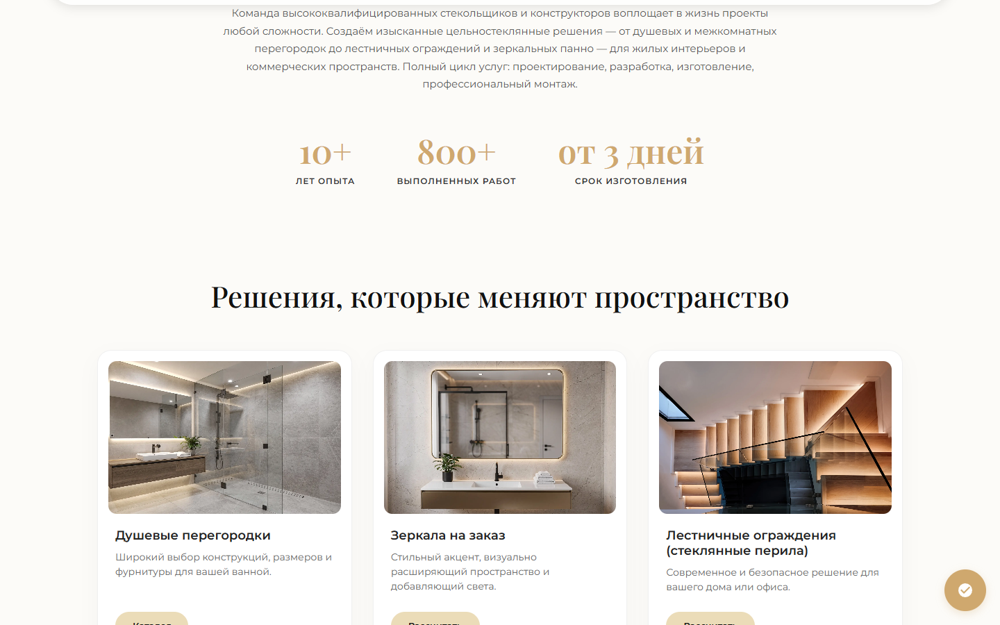

# Vsesteklo — site + production CRM / сайт + CRM — showcase

| | |
|--|--|
| 🌐 Site | https://vsesteklo.ru/ |
| 🖥️ CRM | https://crm.vsesteklo.ru/ |

## Скриншоты / Screenshots




---

## 🇷🇺 Русский

### О проекте
**Всестекло** — производство стекла и зеркал. Публичный сайт для клиентов и **внутренняя CRM**, которой пользуются каждый день: цены, заявки, калькулятор, парсер конкурентов, отзывы.

Сайты **до сих пор в проде**.

### Что сделано
- Сайт-каталог изделий (перегородки, зеркала, лестницы и т.д.)
- **CRM** — операционка бизнеса, не «админка лендинга»
- **Прайс-контроль** — живые цены на сайте по артикулам
- **Инженерный калькулятор** — расчёт по геометрии, толщине, кромке, вырезам, фурнитуре
- **Заявки с сайта** — воронка лидов в CRM
- **Отчёты парсера** — мониторинг цен конкурентов/поставщиков
- **Модерация отзывов**, аналитика за м²
- Роли: админ, менеджер, инженер, замерщик

### Стек: что за что

| Часть | Технологии | Для чего |
|--------|------------|----------|
| Публичный сайт | HTML, CSS, JavaScript | Каталог, SEO, формы, вход в расчёт |
| CRM | Vue SPA | Админка: прайс, заявки, парсер, отзывы, роли |
| API / данные | Node.js | Лиды, прайсы, бэкенд CRM |
| Парсер | Node.js | Прайс-листы конкурентов |
| SEO / аналитика | robots, sitemap, Метрика | Трафик |
| Уведомления | Telegram | Алерты менеджерам |

### Поток
```
Сайт / калькулятор → заявка → CRM
                    ↘ прайс-контроль → цены на сайте
                    ↘ парсер → маржа
                    ↘ отзывы → модерация → сайт
```

### Код
Коммерческий проект: исходный код закрыт и хранится в приватном репозитории. Здесь — описание, стек и скриншоты.

---

## 🇬🇧 English

### About
**Vsesteklo** is a glass & mirror manufacturing business: a public website for customers and an **internal CRM** used daily for prices, leads, engineering quotes, competitor monitoring, and reviews.

Both domains are **still in production**.

### What was built
- Public product catalog (partitions, mirrors, stairs, etc.)
- **Production CRM** — business ops hub, not a brochure admin
- **Price control** — live catalog prices by SKU
- **Engineering calculator** — parametric pricing (geometry, thickness, edges, cutouts, hardware)
- **Website leads** — funnel into the CRM pipeline
- **Parser reports** — competitor/supplier price monitoring
- **Review moderation**, m² analytics
- Roles: admin, manager, engineer, measurer

### Stack: what each layer is for

| Layer | Tech | Purpose |
|--------|------|---------|
| Public site | HTML, CSS, JavaScript | Catalog, SEO, forms, calculator entry |
| CRM | Vue SPA | Admin: prices, leads, parsers, reviews, roles |
| API / data | Node.js | Leads, prices, CRM backend |
| Parser | Node.js | Competitor price lists |
| SEO / analytics | robots, sitemap, Metrika | Traffic |
| Notifications | Telegram | Manager alerts |

### Flow
```
Site / calculator → lead → CRM
                   ↘ price control → live site prices
                   ↘ parser → margin
                   ↘ reviews → moderation → site
```

### Code
Commercial project: the source is private. This repository is a showcase — overview, stack and screenshots.

---

**Author:** [Ruslan Kovalchuk](https://github.com/Arctillect-RK) · [Telegram](https://t.me/Arctillect)
